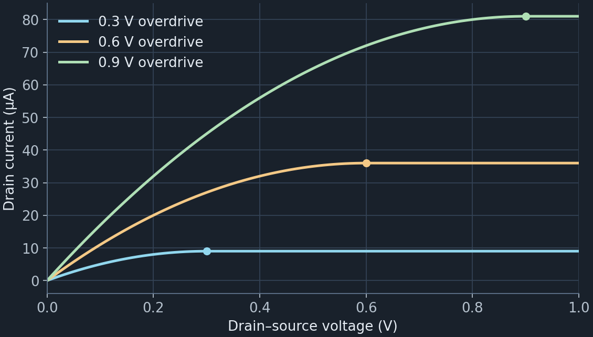

# 1. From the MOS transistor to a logic gate

The selection logic of an instruction decoder must drive a following stage to a recognizable voltage before that stage samples it. A truth table gives the selected instruction for every pattern of inputs. Physically, each selection is produced by moving charge onto or off a node. The circuit can compute the right Boolean expression and still fail because it cannot move enough charge in time.

Use one running example throughout the notes. A small execution slice decodes two one-bit controls, uses the decoded result to select a data source, adds it to an operand, and conditionally registers the result. Call the controls $a$ and $b$. Begin with the match signal that detects $a=b=1$. Its complement, $n=\overline{ab}$, is a NAND output. Delaying, sizing, mapping, and checking versions of this slice will expose different ways that implementation can fail.

## Four terminals and complementary switching [L01 12:01](https://www.youtube.com/watch?v=WBa2Fw5-yU4&t=721s)

A metal–oxide–semiconductor field-effect transistor, or MOSFET, has a gate, source, drain, and body. The insulator under the gate lets a voltage control the mobile carriers near the semiconductor surface. In an enhancement-mode n-channel MOSFET (NMOS), the heavily doped source and drain are n-type, and a sufficiently positive gate relative to the source establishes an electron inversion channel between them in a p-type body. A p-channel MOSFET (PMOS) uses opposite polarities and holes. The body connection changes the available voltages and the threshold, so it matters even when a circuit symbol suppresses it.

Let $V_{DD}>0$ be the supply voltage relative to ground. An inverter connects its PMOS between $V_{DD}$ and its output and its NMOS between output and ground. A common gate input near ground turns the PMOS on and the NMOS off. The output capacitance charges toward $V_{DD}$. An input near $V_{DD}$ reverses those conditions and discharges it. By putting two NMOS devices in series, the NAND output discharges only when both inputs are high. Two PMOS devices in parallel provide a charging path when either input is low. Across four input combinations there is one conducting network in this ideal switch model.

The same Boolean gate occupies a specific physical geometry. The gate electrode crosses the active region at each device. A layout must connect source and drain using shared diffusion or contacts and metal as appropriate, and tie the body or well to the intended potential. Normalize a hand sketch with a length unit $\lambda$ when using the lecture's educational rules. Fabrication dimensions, enclosures, and spacings come from the actual process design rules.

## Charge and current in the long-channel approximation [L02 04:02](https://www.youtube.com/watch?v=R-mMcqMXqmk&t=242s) · [L02 16:00](https://www.youtube.com/watch?v=R-mMcqMXqmk&t=960s)

Consider an NMOS with body tied to source. Let $V_{GS}$ and $V_{DS}\ge 0$ denote gate–source and drain–source voltages, and $V_T$ the threshold of the approximation. The **overdrive** is $V_O=V_{GS}-V_T$. Accumulation means that the gate attracts holes at the p-type surface. Positive gate bias first depletes holes and eventually forms the inversion layer. Once the channel is established, its charge varies along its length because the channel potential rises from source to drain.

Let $x$ be distance from the source, $L$ the channel length, $W$ the width, $\mu_n$ the electron mobility, and $C_{ox}$ the gate oxide capacitance per unit area. The inversion charge magnitude per area is approximated by $C_{ox}(V_O-V(x))$, where $V(x)$ is the channel voltage relative to source. With drift speed proportional to the lateral voltage gradient and constant drain current $I_D$, the current magnitude is $I_D=\mu_n W C_{ox}(V_O-V)\,dV/dx$. Integrating from source to drain gives, for $0\le V_{DS}\le V_O$ and $V_O>0$,

$$
I_D=\beta\left(V_OV_{DS}-\frac{V_{DS}^2}{2}\right),\qquad
\beta=\mu_n C_{ox}W/L.
$$

Here $\beta$ has units amperes per volt squared. When $V_{DS}=V_O$, the inversion charge at the drain end tends to zero. In the ideal saturation model the integration ends at the pinch-off point and yields $I_D=\beta V_O^2/2$ at larger drain voltages. The small-$V_{DS}$ slope is $\beta V_O$, so the inverse slope has units of resistance. As a check, if $\beta=200\,\mu\mathrm{A/V^2}$ and $V_O=0.6\,\mathrm V$, the current at $V_{DS}=0.2\,\mathrm V$ is $20\,\mu\mathrm A$ and the ideal saturation current is $36\,\mu\mathrm A$. The two expressions agree at $0.6\,\mathrm V$.

*Increasing overdrive moves the onset of saturation to higher drain voltage and raises the plateau quadratically in the long-channel model.*

## Capacitance, pass levels, and process corners [L02 36:00](https://www.youtube.com/watch?v=R-mMcqMXqmk&t=2160s) · [L02 60:00](https://www.youtube.com/watch?v=R-mMcqMXqmk&t=3600s)

An input drives gate, overlap, and interconnect capacitance. A NAND output also sees the junctions of all diffusion connected to its output and the next stage's input capacitance. As a first-order scaling argument, doubling a transistor's width approximately doubles drive and intrinsic capacitance. An isolated stage driving a large fixed external load benefits. In a chain, the preceding stage pays for the larger input, and the intrinsic part of the delay no longer scales away.

An NMOS switch with gate held at $V_{DD}$ can pass ground strongly. While charging a node high, the node's rising voltage reduces the switch's gate–source voltage. In the simple model the charge current falls toward zero near $V_{DD}-V_T$. A PMOS passes a strong high and a degraded low. Body effect can further change the NMOS pass threshold as the node rises. The threshold-based switch picture explains why complementary switches are useful in Chapter 2.

Velocity saturation weakens the long-channel dependence on overdrive. Channel-length modulation produces a nonzero output slope in saturation. Drain-induced barrier lowering can reduce effective threshold at higher drain voltage and increase off-state current. Subthreshold and junction leakage make the static current finite. A corner combines characterized process, voltage, and temperature assumptions. Use the long-channel model for mechanism and scaling intuition, and a characterized device model for process-specific predictions. The Berkeley BSIM manuals document the extra dependencies represented in compact models. [Berkeley BSIM4](https://www.bsim.berkeley.edu/models/bsim4/)

## Laboratory and solved problems

Run [the numerical laboratory](../code/lab.py) with `python code/lab.py mos`. It checks the three current regimes and continuity at the pinch-off boundary using the values above.

1. **Where is the small-voltage approximation useful?** With $V_O=0.6\,\mathrm V$ and $V_{DS}=0.2\,\mathrm V$, the linear approximation predicts $200(0.6)(0.2)=24\,\mu\mathrm A$. The exact quadratic within this model gives $20\,\mu\mathrm A$. The quadratic correction is one sixth of the linear term here. Its relative size in that term is $V_{DS}/(2V_O)$, so the approximation improves as the drain voltage approaches zero.
2. **Why does a series stack drive differently?** Both devices must conduct for the NAND to fall. The intermediate node moves during discharge, changing the upper device's overdrive and the charge the network must remove. Two identical fixed resistors in series give a first estimate of twice the resistance. A transistor-level transient simulation can show the input-order and intermediate-node effects that estimate suppresses.
