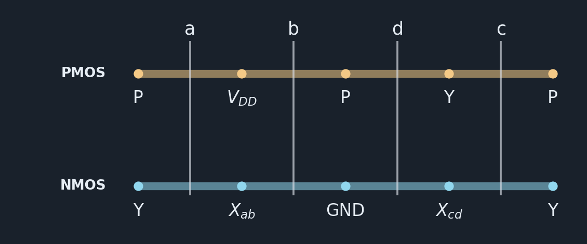
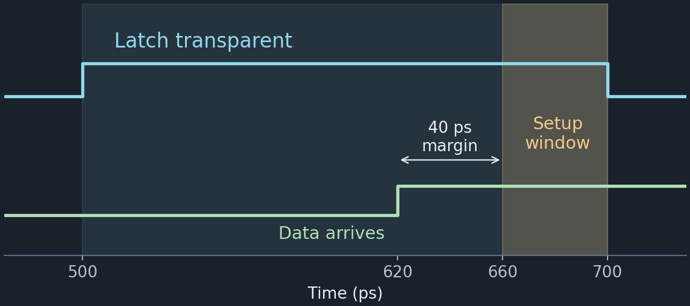

# 2. Static CMOS, delay, and sequential state

The execution slice uses a selection function to route data before capture. A transistor-level review asks three questions. Can the selector represent both logic levels? How long after a change is the data valid? Will the storage element see the intended value near its sampling edge?

## Synthesize the conducting networks [L03 04:03](https://www.youtube.com/watch?v=EK3Q3donQeQ&t=243s) · [L03 24:03](https://www.youtube.com/watch?v=EK3Q3donQeQ&t=1443s)

Let $Y$ be a gate output and use juxtaposition for Boolean AND, $+$ for OR, and an overbar for negation. The NMOS pull-down implements the condition $Y=0$. Construct series chains for AND and parallel branches for OR. The PMOS pull-up uses the dual connection with the same gate signals. The gate polarity reverses each device's conduction, and exchanging series with parallel applies De Morgan's law. For $Y=\overline{ab+c}$, the pull-down is an $a,b$ series chain in parallel with $c$. The pull-up puts the parallel $a,b$ pair in series with $c$. If $c=1$, the lone NMOS gives a discharge path while the PMOS controlled by $c$ interrupts the supply path. If $c=0$ and $a=0$, the PMOS devices controlled by $a,c$ provide a charge path while both alternatives in the pull-down are broken.

A **transmission gate** pairs an NMOS and PMOS in parallel using complementary gate controls. One device carries each extreme of the input voltage efficiently. With two transmission gates and selection bit $s$, the enabled data branch implements $Y=\bar s d_0+s d_1$ for input bits $d_0,d_1$. The bidirectional switch gives no voltage gain. At steady state one branch should conduct, and the driver must restore logic levels if the passed signal is degraded. During imperfect transitions on the select pair the network may briefly float or contend. A static restoring multiplexer uses additional devices and has different timing arcs.

A **tri-state inverter** drives the complement of its input when enabled and presents high impedance when disabled. Complementarily enabled tri-state inverters can drive a shared node to the complement of the selected input. A following inverter restores the intended polarity. Contrast the driven node with the transmission-gate node, where the selected upstream driver supplies the charge through a switch. Turning on two opposing tri-state drivers creates contention. Turning both off leaves the shared node relying on stored charge. [L03 32:40](https://www.youtube.com/watch?v=EK3Q3donQeQ&t=1960s) · [L03 40:34](https://www.youtube.com/watch?v=EK3Q3donQeQ&t=2434s)

Layout affects implementation even when the schematic matches. A **stick diagram** sketches routing topology and device crossings. An Euler trail through a transistor network visits each transistor edge once and can make it possible to share the diffusion between successive devices. For the two complementary networks, a common gate ordering can align the polysilicon crossings and reduce diffusion breaks. Actual cell architecture also depends on body ties, pin access, routing tracks, and design rules. [L03 44:00](https://www.youtube.com/watch?v=EK3Q3donQeQ&t=2640s)

The lecture's **AOI22** example (AND–AND–OR–invert) computes $Y=\overline{ab+cd}$. The NMOS network has two series branches in parallel. From $Y$, traverse $a,b$ down one branch, then $d,c$ backwards up the other. For the PMOS network, let $P$ be the junction between the two parallel pairs. From $P$, traverse $a$ to $V_{DD}$, $b$ back to $P$, $d$ to $Y$, and $c$ back to $P$. Both walks use the gate order $a,b,d,c$. The repeated node labels in the drawing denote electrical connections to be routed. In the annotated NAND3 layout, the three bottom gates instead form one series path, with two internal diffusion nodes and only the end connections to output and ground. The three top devices share supply and output nets in parallel. The example cell is $32\lambda$ wide and $40\lambda$ high. [L03 14:33](https://www.youtube.com/watch?v=EK3Q3donQeQ&t=873s) · [L03 56:35](https://www.youtube.com/watch?v=EK3Q3donQeQ&t=3395s)

*Common gate ordering in AOI22. The strips show connectivity with wiring and process dimensions omitted.*

## Turn a voltage waveform into a delay number [L04 24:37](https://www.youtube.com/watch?v=_1pBznDWZMg&t=1477s) · [L04 35:49](https://www.youtube.com/watch?v=_1pBznDWZMg&t=2149s)

The DC voltage transfer curve specifies settled output $V_{out}$ for input $V_{in}$. The input thresholds $V_{IL}$ and $V_{IH}$ for an idealized inverter characterization often come from the two points where $dV_{out}/dV_{in}=-1$. If $V_{OL}$ is the maximum guaranteed low output and $V_{OH}$ the minimum guaranteed high output, the low margin is $V_{IL}-V_{OL}$ and the high margin is $V_{OH}-V_{IH}$. With thresholds $0.35$ and $0.65$ V and outputs $0.05$ and $0.95$ V, both margins are $0.30$ V. These are DC quantities. A transient disturbance depends on its width, coupling, and the receiving element's dynamics.

The **switching point** $V_M$ is where the DC curve crosses $V_{out}=V_{in}$. Take an inverter in which both transistors conduct at this crossing and use the long-channel model of Chapter 1. Both are in saturation there because each gate–source voltage equals its drain–source voltage in magnitude. Let $V_{Tn}$ and $|V_{Tp}|$ be positive threshold magnitudes and $\beta_n,\beta_p$ the corresponding current coefficients. Equal pull-up and pull-down currents give

$$
\sqrt{\beta_n}(V_M-V_{Tn}) =
\sqrt{\beta_p}(V_{DD}-V_M-|V_{Tp}|).
$$

At $V_{DD}=1$ V with both threshold magnitudes $0.25$ V and equal coefficients, $V_M=0.5$ V. If $\beta_p=4\beta_n$, solving $V_M-0.25=2(0.75-V_M)$ gives $V_M=7/12$ V. A stronger pull-up requires a larger input voltage to balance the current. The unity-slope thresholds still have to be obtained from the transfer curve. [L04 08:01](https://www.youtube.com/watch?v=_1pBznDWZMg&t=481s)

The load-line slide shows how to find the output away from the switching point. Hold $V_{in}$ at $0.6V_{DD}$ and plot both device current magnitudes against $V_{out}$. The NMOS uses $V_{DS}=V_{out}$. The PMOS uses positive magnitudes $V_{SG}=V_{DD}-V_{in}$ and $V_{SD}=V_{DD}-V_{out}$. Their intersection is the DC output because the output node has zero net charging current there. With the symmetric 1 V example, the overdrives are $0.35$ V and $0.15$ V. Write $v$ for the output's numerical value in volts. For a linear NMOS and a saturated PMOS, cancellation of their common coefficient gives $0.35v-v^2/2=0.15^2/2$. The lower root is $0.35-\sqrt{0.10}\approx0.0338$, which satisfies both assumed operating regions. The other root exceeds the NMOS overdrive and must be discarded. [L04 08:43](https://www.youtube.com/watch?v=_1pBznDWZMg&t=523s) · [L04 15:29](https://www.youtube.com/watch?v=_1pBznDWZMg&t=929s)

Replace the conducting network for a falling output by an effective resistance $R$ in ohms and the charge storage by capacitance $C$ in farads. With initial output voltage $V_{DD}$, current balance gives $C\,dV/dt=-V/R$. Separating variables and imposing the initial condition yields $V(t)=V_{DD}e^{-t/(RC)}$. The 50% crossing occurs at $t_{50}=RC\ln 2$. For $R=2\,\mathrm{k\Omega}$ and $C=20\,\mathrm{fF}$, $RC=40$ ps and $t_{50}=27.73$ ps. The fall time from $0.9V_{DD}$ to $0.1V_{DD}$ is $RC\ln9=87.89$ ps. Propagation delay is measured between input and output threshold crossings. Slew measures the time spent between two thresholds on the same pin. Library conventions determine the thresholds used for each measurement.

The NAND's internal node exposes a limit of single-capacitor models. If the transistor next to ground turns on last, the intermediate node may first have charged through the upper device and can now add to the discharge work. A different switching history can give a different delay with the same final input vector. Use pin-specific rising and falling arcs and check simultaneous switching assumptions when interpreting a characterized model.

For a two-resistor sketch, use $R_b$ from ground to the internal node with capacitance $C_x$, and $R_t$ from that node to the output with capacitance $C_y$. When both nodes start at the same voltage and both devices are replaced by resistors, the output first moment is $R_b(C_x+C_y)+R_t C_y$. The shared bottom resistance discharges both capacitors. With $R_b=R_t=1$ kΩ, $C_x=5$ fF, and $C_y=20$ fF, the moment is 45 ps, compared with 40 ps if internal capacitance is omitted. This is a moment of the linear step response. The actual 50% crossing depends on the waveform and initial state. [L04 54:35](https://www.youtube.com/watch?v=_1pBznDWZMg&t=3275s)

## Store a bit through a feedback phase [L05 07:36](https://www.youtube.com/watch?v=Yo_ttSD6o-k&t=456s) · [L05 35:29](https://www.youtube.com/watch?v=Yo_ttSD6o-k&t=2129s)

A static latch combines a data path and a regenerative feedback path. In the transparent phase, input data can propagate to its output. In the opaque phase, feedback maintains the sampled value. An edge-triggered register can be built by cascading two latches with complementary phases. The first latch stops tracking at the capture edge and the second exposes the stored result. Real devices require nonzero switching time and clock waveforms that prevent unintended transparency through both stages.

**Setup time** specifies how long data must be stable before the sampling edge under the characterized conditions. **Hold time** specifies a post-edge stability requirement. **Clock-to-output delay** measures the time from a valid clock edge to the output transition. If the execution slice launches a result through one storage element and captures in the next, the available clock period must accommodate launch delay, combinational delay, and capture setup time after accounting for clock arrival differences. An input crossing in the sampling aperture can leave the internal feedback nodes temporarily near an unstable equilibrium. Circuit gain eventually drives them away from that point, with a resolution time that depends on the initial imbalance. Digital simulation samples logical values, so modeling metastability requires additional device or statistical assumptions.

Maximum propagation delay bounds the time for a transition to reach the specified output criterion. Minimum contamination delay bounds how early a previous value can cease to be valid in the digital model. Under a common ideal edge with no skew, if the launching register's minimum clock-to-output delay is 20 ps and the logic contamination delay is 15 ps, the earliest new data arrives at 35 ps. A 40 ps hold requirement therefore fails by 5 ps even if setup passes. [L05 37:01](https://www.youtube.com/watch?v=Yo_ttSD6o-k&t=2221s)

A latch opening at 500 ps and closing at 700 ps with 40 ps setup can accept data at 620 ps. It uses 120 ps after opening and still has 40 ps margin to the 660 ps latest arrival. This is **time borrowing**. During transparency the late data also launches into the following logic later, consuming some of its budget. For two-phase or pulsed latches, check the earliest data arrival and transparency overlap as well as the latest one. A short path can otherwise race through two simultaneously transparent stages. [L05 44:39](https://www.youtube.com/watch?v=Yo_ttSD6o-k&t=2679s) · [L05 52:39](https://www.youtube.com/watch?v=Yo_ttSD6o-k&t=3159s)

*The original timing example redrawn on one time axis. A real two-phase latch path also includes latch propagation delay, skew, and the next closing edge.*

The annotated pulsed-latch timing diagram exposes a short-path penalty. Assume two latches open together at the start of a pulse of width $t_w$. Let $t_{cq,min}$ be minimum launch clock-to-output delay, $d_{min}$ minimum logic delay, and $t_h$ capture hold measured from pulse closure. New data can reach the second latch at $t_{cq,min}+d_{min}$, while the old value must persist through $t_w+t_h$. So the minimum-delay condition in this aligned-pulse model is $t_{cq,min}+d_{min}\ge t_w+t_h$. Widening the pulse increases the opportunity to borrow time and also makes it harder to prevent new data from racing into the receiving latch. [L05 45:48](https://www.youtube.com/watch?v=Yo_ttSD6o-k&t=2748s) · [L05 51:41](https://www.youtube.com/watch?v=Yo_ttSD6o-k&t=3101s) · [Weste and Harris, Sequential Circuit Design](https://pages.hmc.edu/harris/cmosvlsi/4e/lect/lect11.pdf)

## Laboratory and solved problems

`python code/lab.py cmos` exhaustively checks the complementary networks of the compound gate and evaluates the RC crossing times. The model uses scalar capacitance and effective resistance. It accepts no files. An independent simulation of [the RC circuit](../code/rc.cir) in ngspice measured 27.726 ps and 87.889 ps.

1. **A selector load doubles. What happens?** With the same effective $R$, the load change doubles both $t_{50}$ and the 90–10% fall time. Upsizing the driver can recover part of that loss, and the previous stage may now see higher input capacitance. Check the complete path since the resulting chain need not be twice as fast.
2. **Why can a latch accept an input update after its opening edge?** During the transparent interval the data path remains enabled. The value captured is determined near the closing edge, subject to its setup and hold aperture. An edge-triggered model discards that interval of transparency and cannot describe time borrowing between latch stages.
