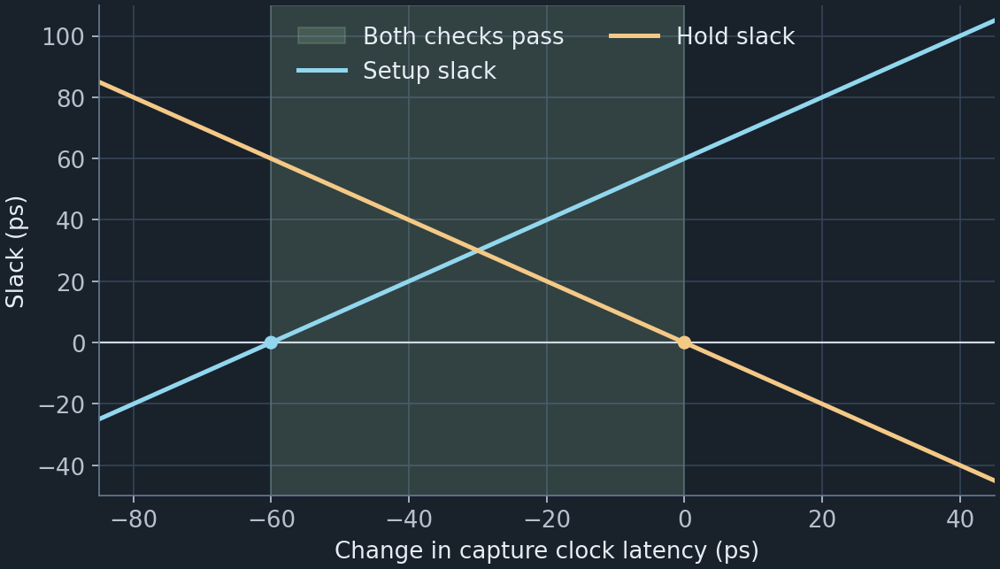

# 9. Static timing, interconnect, and clock exceptions

A timing violation is an inequality between two clock-referenced events. To know how to repair it, recover the sign of each term, identify the source of its delay estimate, and check whether the hardware can exercise the selected edge relationship.

## Propagate earliest and latest arrivals [L28 23:39](https://www.youtube.com/watch?v=Vo5VS5rJtyU&t=1419s) · [L28 47:41](https://www.youtube.com/watch?v=Vo5VS5rJtyU&t=2861s)

A **timing graph** uses pins as vertices and propagation or check relations as arcs. For an acyclic combinational region and fixed scalar delay $d(u,v)$ on arc $(u,v)$, the latest arrival $A_{max}(v)$ is the maximum over predecessor arrival plus arc delay. The earliest arrival $A_{min}(v)$ is the corresponding minimum. This follows because every path to $v$ ends in one of the incoming arcs. A topological order lets each recurrence reuse computed arrivals. Required times propagate backward. For a single late requirement $R(v)$, a predecessor's allowable latest arrival is $R(v)-d(u,v)$. If there are several downstream requirements, take their minimum. Sensitized paths, rise/fall transitions, slew, distinct clocks, and path exceptions add state to the propagation beyond this graph model. [OpenSTA timing engine and arc API](https://github.com/The-OpenROAD-Project/OpenSTA/blob/master/doc/StaApi.md)

Use one associated setup launch and capture edge and a same-cycle hold check. Let $L$ and $C$ be the launch and capture clock insertion latencies in picoseconds, $T$ the period, $Q_{max}$ and $Q_{min}$ clock-to-output delays, $D_{max}$ and $D_{min}$ data-path delays, $S$ setup and $H$ hold, and $U_s,U_h$ positive uncertainty allowances. Setup requires

$$
L+Q_{max}+D_{max}\le T+C-S-U_s.
$$

Hold requires

$$
L+Q_{min}+D_{min}\ge C+H+U_h.
$$

Subtract actual from required for setup slack and required from actual for hold slack. This makes positive slack a pass in both checks. Later capture increases setup slack by the same amount it decreases hold slack if other terms are fixed. Separate early and late clock latencies replace these common $L,C$ values in a real analysis.

For $T=1000$, $L=60$, $C=95$, $Q_{max}=80$, $Q_{min}=35$, $D_{max}=810$, $D_{min}=30$, $S=60$, $H=20$, $U_s=25$, and $U_h=10$ ps, the setup arrival is 950 ps and required time 1010 ps, giving +60 ps. Hold arrival is 125 ps and required time 125 ps, giving zero. An extra 15 ps of capture latency improves setup to +75 ps and creates −15 ps hold slack. This is why a faster setup report cannot certify hold. An advanced timer reevaluates cell delay and slew in each corner and may choose different paths through reconvergent logic.

*If all other timing terms stay fixed, both inequalities hold for a capture shift between −60 ps and 0 ps. The endpoints are the zero-setup and zero-hold boundaries.*

## Model interconnect resistance and capacitance [L29 12:08](https://www.youtube.com/watch?v=A9vzgrr-9Gc&t=728s) · [L29 43:41](https://www.youtube.com/watch?v=A9vzgrr-9Gc&t=2621s)

A long net has resistance along its conductors and capacitance to reference or neighboring conductors. A lumped load places capacitance at one point. A distributed RC tree assigns capacitance to nodes and resistance to branches. For a root driving node $v$, the Elmore first moment for a tree is the sum over resistors on the root-to-$v$ route of each resistance times the total capacitance downstream of that resistor. Each capacitor contributes only along the part of its charging path shared with the observed node's path. The moment has units of time. A single-pole network's 50% crossing is the moment times $\ln2$. A general multipole tree can have the same moment with a different waveform. [Elmore, The Transient Response of Damped Linear Networks](https://doi.org/10.1063/1.1697872)

Consider driver resistance $R_0=1$ kΩ leading to a branch point with $C_0=10$ fF. Two branches each lead to a leaf, with resistances $R_1=0.5$ kΩ and $R_2=1.0$ kΩ and capacitances $C_1=20$ fF and $C_2=30$ fF. The first moment at leaf 1 is $R_0(C_0+C_1+C_2)+R_1C_1=70$ ps. At leaf 2 it is $60+30=90$ ps. Removing branch 2's capacitance reduces leaf 1's moment by 30 ps because they share the driver. Moving branch 2 farther away by increasing $R_2$ does not enter leaf 1's first moment, although the full transient response can still change. A timer combines library arcs with parasitics and may compute effective capacitance for the driver to account for screening by wire resistance.

## Define clock relationships and justified exceptions [L30 09:17](https://www.youtube.com/watch?v=X5vbEFgNqEs&t=557s) · [L30 45:04](https://www.youtube.com/watch?v=X5vbEFgNqEs&t=2704s)

A clock has a period and edge waveform. A **generated clock** has a specified relation to an existing clock, such as a known divider or inversion. Capture/launch phase is then traceable to the master context. Clock latency is arrival relative to the defined reference point. Clock skew is a difference between clock arrivals. Uncertainty is an allowance that may represent jitter and residual margin. Keep source latency, network latency, and uncertainty separate when reconciling constraints with a report.

A **false path** is excluded from a specified timing analysis based on a justified operating or functional condition. A **multicycle path** changes the checked edge relationship because the design is guaranteed more time or a different capture schedule. A two-cycle setup relationship in a same-clock example moves the nominal setup capture edge from $T$ to $2T$. It can also shift associated hold checking under the tool's defaults. Inspect reported launch and capture edges after applying both setup and accompanying hold intent. A data path that can update and be captured on every cycle has no two-cycle contract even if a simulation happened to use alternating enables. A genuinely asynchronous crossing needs a domain-crossing strategy and a separate correctness argument.

**Case analysis** models a constant mode signal and can disable arcs made impossible by that mode. Excluding all paths through a selector is much broader than selecting one mode and checking a separate scenario for the other. Before accepting an exception, list its covered startpoints, through objects, endpoints, and checks. Confirm which paths remain timed by inspecting representative before/after reports. [L30 63:25](https://www.youtube.com/watch?v=X5vbEFgNqEs&t=3805s)

## Laboratory and solved problems

`python code/lab.py sta` evaluates the arrival recurrences, both clock inequalities, and the RC moments. Its graph uses topologically ordered scalar min/max arcs.

1. **What does a 20 ps increase in period do to the example?** The setup required time rises to 1030 ps with the same edge relationship, so setup slack rises from +60 to +80 ps. Both hold edges remain in the same cycle and hold slack remains zero.
2. **What if the leaf-1 capacitance doubles?** The shared driver term grows by $1\,\mathrm{k\Omega}\times20\,\mathrm{fF}=20$ ps at both leaves. Only leaf 1 adds another 10 ps from its branch resistance. Its moment becomes 100 ps, and leaf 2's becomes 110 ps.
